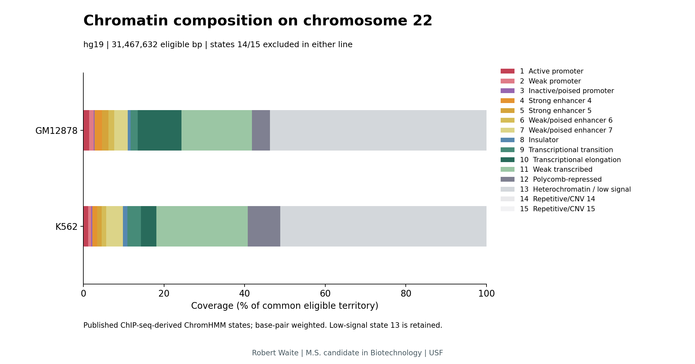
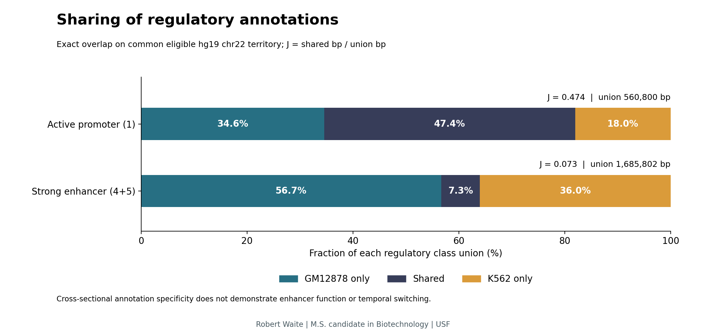

# Regulatory Region Review

**Robert Waite · M.S. candidate in Biotechnology · University of South Florida (USF)**

An interactive exploration of how chromatin-state annotations differ between
two human cell lines, built around exact genomic overlap and reproducible
analysis of public ENCODE data.

## Project summary

Thiss Chromatin Atlas asks whether candidate enhancer regions are more specific
to cellular context than active-promoter regions. It compares published
ChromHMM annotations in GM12878 and K562 on human chromosome 22, measuring how
many DNA bases carry the same regulatory class in both cell lines.

Strong-enhancer annotations are substantially less shared: their Jaccard overlap
is **0.0732**, compared with **0.4740** for active promoters across **31.47 million
eligible bases**. This pattern remains when the territory mask or enhancer
definition is changed. The result describes annotation specificity in these
two lines; it does not establish enhancer function or changes over time.

## Explore the results

Open [`docs/index.html`](docs/index.html) in a web browser to use the explorer.
When viewing the repository on GitHub, download the HTML file and open it
locally. The app runs offline without a server or additional installation.

- **Regulatory sharing:** compare GM12878-only, shared and K562-only fractions
  of each class and inspect their exact base counts.
- **Chromatin composition:** compare coverage of all 15 published states using
  the same eligible-territory denominator.
- **Paired-state map:** select a matrix cell to see how many bases receive a
  particular pair of annotations.
- **Sensitivity controls:** retain or exclude repetitive/CNV states and switch
  between strong and broad enhancer definitions.
- **Interval explorer:** inspect exact hg19 chr22 coordinates and their local
  state assignments.
- **Exports:** download results as CSV or an attributed sharing figure as SVG.

For the analysis narrative, read the executed [`analysis.ipynb`](analysis.ipynb)
or the detailed [`REPORT.md`](REPORT.md). A short overview is in
[`SUMMARY.md`](SUMMARY.md).

## Main findings

| Regulatory class | Shared bases | Bases in either line | Jaccard overlap |
|---|---:|---:|---:|
| Active promoter, state 1 | 265,800 | 560,800 | 0.473966 |
| Strong enhancer, states 4/5 | 123,400 | 1,685,802 | 0.073200 |

Jaccard overlap is **shared bases divided by bases in either line**. Each class
has its own union denominator. A value of 0.0732 means 7.32% of the enhancer
union carries the enhancer class in both lines; it is not a measurement of
enhancer activity.



**Figure 1.** Published ChIP-seq-derived ChromHMM state coverage as a percentage
of 31,467,632 common eligible bases. Coverage is weighted by interval length;
low-signal state 13 is retained. Composition does not measure regulatory strength.



**Figure 2.** Class-specific union fractions assigned only in GM12878, in both
lines, or only in K562. Active-promoter Jaccard exceeds strong-enhancer Jaccard
by **40.08 percentage points**. Shared labels do not establish equivalent function.

## Data and method

The inputs are published ENCODE/Broad ChromHMM segmentations in
**GRCh37/hg19**, lifted from the original hg18 annotations. GM12878 is a
lymphoblastoid line; K562 is an erythroleukemia line. The analysis reuses the
published state assignments rather than training a new predictor.

An exact interval sweep compares bases covered by both tracks. The primary
analysis excludes any base labeled repetitive/CNV state 14 or 15 in either
line, leaving 31,467,632 eligible bases. All calculations use zero-based,
half-open coordinates and preserve lifted interval boundaries. Source hashes,
quality checks and precise definitions are recorded with the results.

Retaining repetitive/CNV territory gives promoter/enhancer Jaccards of
0.4370/0.0681. Expanding enhancers to include weak/poised states gives enhancer
Jaccards of 0.1431 under the primary mask and 0.1329 with repetitive/CNV territory
retained. Promoter sharing remains greater in every comparison.

## Interpretation

The pattern is consistent with context-dependent candidate enhancer annotation.
Lineage, transformation, assay variation and state-calling uncertainty are
competing explanations. This is a restricted, cross-sectional comparison of
one chromosome and two cell lines. It cannot identify target genes, demonstrate
enhancer function, or measure temporal switching. Correlated bases are not
independent biological replicates; no inferential p-values are reported.

## Reproduce the analysis

Use Python 3.12 from the repository root:

```sh
python -m pip install -r requirements-dev.txt
python -m chromatin_atlas
python -m pytest -q
```

The source data are included. `--download` retrieves absent inputs after
checksum verification. `requirements-lock.txt` records the reference dependency
versions. The notebook, generated charts, processed tables and offline app are
all included. See [`VALIDATION.md`](VALIDATION.md) for numerical and interface
checks.

## Sources and attribution

Experimental data: ENCODE Consortium, Broad Institute and Bernstein laboratory.
Chromatin-state segmentation: Kellis group; [Ernst et al. (2011), Nature](https://doi.org/10.1038/nature09906).
GM12878: wgEncodeEH000784 / GSM936082. K562: wgEncodeEH000790 / GSM936088.

See [`data/SOURCES.md`](data/SOURCES.md) for source URLs, assembly provenance and
data-use terms. Original project code is [MIT licensed](LICENSE); source
annotations retain their original terms. Project citation metadata is supplied
in [`CITATION.cff`](CITATION.cff).
